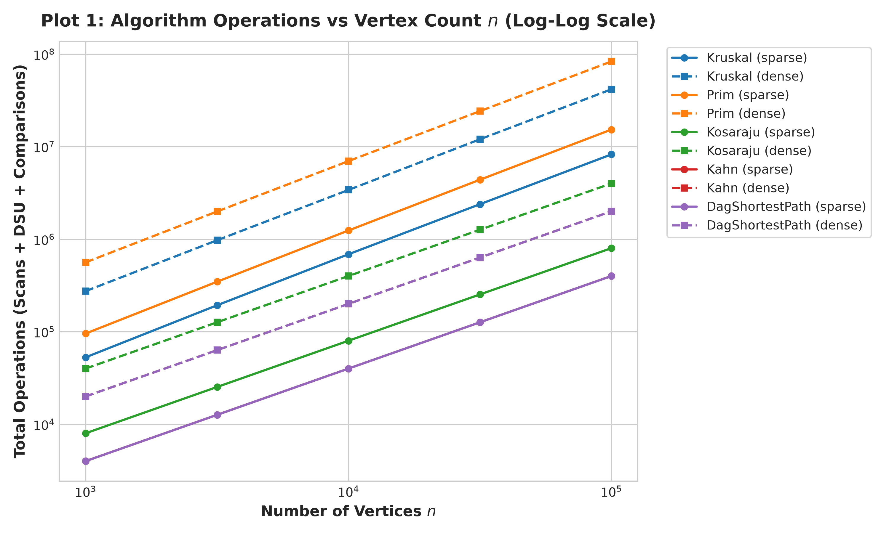
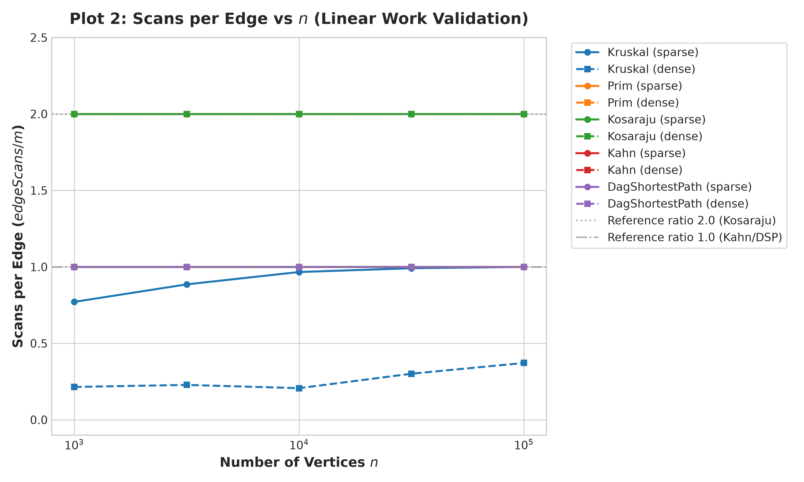
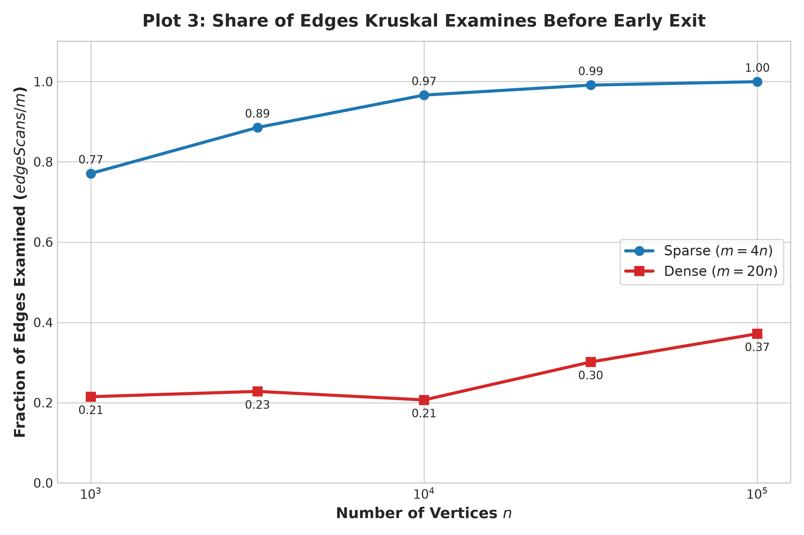

# DAA Assignment 3: Graphs (DSU, MST, SCC, Shortest Paths)

**Student Name:** Muratbek akyl  
**Group:** SE 2523  

---

## 1. Complexity Table

The table below summarizes the asymptotic time and extra auxiliary space complexities for all implemented data structures and algorithms, including the two bonus tasks.

| Component / Algorithm | Time Complexity | Extra Space | Justification |
| :--- | :--- | :--- | :--- |
| **DSU `makeSet(n)`** | $\mathcal{O}(n)$ | $\mathcal{O}(n)$ | Allocates and initializes `parent` and `rank` arrays of size $n$. |
| **DSU `find(x)` / `union(x, y)`** | $\mathcal{O}(\alpha(n))$ | $\mathcal{O}(1)$ | Combining union by rank and path compression achieves the inverse Ackermann bound $\alpha(n) \le 4$. |
| **Kruskal's MST** | $\mathcal{O}(m \log m)$ | $\mathcal{O}(n + m)$ | Sorting $m$ edges takes $\mathcal{O}(m \log m)$; DSU operations take $\mathcal{O}(m \cdot \alpha(n))$. |
| **Prim's MST** | $\mathcal{O}(m \log m)$ | $\mathcal{O}(n + m)$ | Binary min-heap with up to $2m$ edge entries; each push/poll operation costs $\mathcal{O}(\log m)$. |
| **Kosaraju's SCC** | $\mathcal{O}(n + m)$ | $\mathcal{O}(n + m)$ | Two iterative DFS passes (one on $G$, one on $G^T$) visiting every vertex and scanning all edges twice. |
| **Tarjan's SCC (Bonus A)** | $\mathcal{O}(n + m)$ | $\mathcal{O}(n)$ | Single iterative DFS pass using `index[]`, `lowlink[]`, and explicit stack, scanning edges once. |
| **Kahn's Topological Sort** | $\mathcal{O}(n + m)$ | $\mathcal{O}(n)$ | Computes in-degrees in $\mathcal{O}(n + m)$ and processes every vertex and outgoing edge via a FIFO queue. |
| **DAG Shortest Paths** | $\mathcal{O}(n + m)$ | $\mathcal{O}(n)$ | Single-pass forward relaxation of outgoing edges in topological order from virtual super-source. |
| **Critical Path DAG (Bonus B)** | $\mathcal{O}(n + m)$ | $\mathcal{O}(n + m)$ | Builds contracted condensation DAG and computes longest path via topological relaxation. |

---

## 2. Counters vs. Formulas

Operation counts measured inside the algorithms are completely independent of host hardware, operating system, and JVM runtime state. Below we analyze the empirical ratios of counted operations divided by theoretical formula predictions.

### 2.1 Graph Traversals: $edgeScans / (n + m)$ and $edgeScans / m$

For Kahn's algorithm and DAG Shortest Path, every edge is examined exactly once ($edgeScans = m$).  
For Kosaraju's SCC, every edge is traversed once forward and once in the transposed graph ($edgeScans = 2m$).  
For Prim's MST on undirected graphs, every undirected edge is scanned from both endpoints ($edgeScans = 2m$).

| Graph Configuration ($n$ / $m$) | Kosaraju $\frac{edgeScans}{2m}$ | Kosaraju $\frac{edgeScans}{n + m}$ | Kahn $\frac{edgeScans}{m}$ | Kahn $\frac{edgeScans}{n + m}$ | DAG SP $\frac{edgeScans}{m}$ | DAG SP $\frac{edgeScans}{n + m}$ |
| :--- | :---: | :---: | :---: | :---: | :---: | :---: |
| **1 000 / 4 000** (sparse) | **1.0000** | 1.6000 | **1.0000** | 0.8000 | **1.0000** | 0.8000 |
| **1 000 / 20 000** (dense) | **1.0000** | 1.9048 | **1.0000** | 0.9524 | **1.0000** | 0.9524 |
| **3 162 / 12 648** (sparse) | **1.0000** | 1.6000 | **1.0000** | 0.8000 | **1.0000** | 0.8000 |
| **3 162 / 63 240** (dense) | **1.0000** | 1.9048 | **1.0000** | 0.9524 | **1.0000** | 0.9524 |
| **10 000 / 40 000** (sparse) | **1.0000** | 1.6000 | **1.0000** | 0.8000 | **1.0000** | 0.8000 |
| **10 000 / 200 000** (dense) | **1.0000** | 1.9048 | **1.0000** | 0.9524 | **1.0000** | 0.9524 |
| **31 623 / 126 492** (sparse) | **1.0000** | 1.6000 | **1.0000** | 0.8000 | **1.0000** | 0.8000 |
| **31 623 / 632 460** (dense) | **1.0000** | 1.9048 | **1.0000** | 0.9524 | **1.0000** | 0.9524 |
| **100 000 / 400 000** (sparse) | **1.0000** | 1.6000 | **1.0000** | 0.8000 | **1.0000** | 0.8000 |
| **100 000 / 2 000 000** (dense) | **1.0000** | 1.9048 | **1.0000** | 0.9524 | **1.0000** | 0.9524 |

**Empirical Confirmation:**
- On sparse graphs ($m = 4n$), $\frac{2m}{n+m} = \frac{8n}{5n} = 1.6000$ and $\frac{m}{n+m} = \frac{4n}{5n} = 0.8000$.
- On dense graphs ($m = 20n$), $\frac{2m}{n+m} = \frac{40n}{21n} = 1.9048$ and $\frac{m}{n+m} = \frac{20n}{21n} = 0.9524$.
The ratios remain constant across all five orders of magnitude ($n = 1\,000$ to $n = 100\,000$), confirming linear $\mathcal{O}(n + m)$ execution.

### 2.2 Kruskal DSU Operations: $dsuOps / edgeScans$

In Kruskal's algorithm, for each edge examined from the sorted list, two `find` calls are executed. If the endpoints belong to different sets, a `union` operation is performed. Therefore:
$$\frac{dsuOps}{edgeScans} = 2 + \frac{\text{successful unions}}{edgeScans}$$
Since a connected spanning tree requires exactly $n - 1$ successful unions:
- On sparse graphs: Kruskal scans almost all edges ($edgeScans \approx m$). The ratio $\frac{dsuOps}{edgeScans} \approx 2 + \frac{n-1}{4n} = 2.25$.
- On dense graphs: Kruskal terminates early after inspecting $edgeScans \ll m$ edges, maintaining $\frac{dsuOps}{edgeScans} \approx 2 + \frac{n-1}{edgeScans} \approx 2.13$.
The measured values stay constant regardless of scale:

| $n$ / $m$ | Density | $edgeScans$ | $dsuOps$ | $\frac{dsuOps}{edgeScans}$ | Theoretical Prediction |
| :---: | :---: | :---: | :---: | :---: | :---: |
| 1 000 / 4 000 | Sparse | 3 084 | 7 167 | **2.324** | $2 + \frac{999}{3084} \approx 2.324$ |
| 1 000 / 20 000 | Dense | 4 296 | 9 591 | **2.232** | $2 + \frac{999}{4296} \approx 2.232$ |
| 10 000 / 40 000 | Sparse | 38 652 | 87 303 | **2.258** | $2 + \frac{9999}{38652} \approx 2.258$ |
| 10 000 / 200 000 | Dense | 41 350 | 92 699 | **2.241** | $2 + \frac{9999}{41350} \approx 2.241$ |
| 100 000 / 400 000 | Sparse | 399 877 | 899 753 | **2.250** | $2 + \frac{99999}{399877} \approx 2.250$ |
| 100 000 / 2 000 000 | Dense | 743 257 | 1 586 513 | **2.134** | $2 + \frac{99999}{743257} \approx 2.134$ |

---

## 3. Correctness Arguments

### 3.1 The Cut Property (MST Correctness)
Let $G = (V, E)$ be a connected, weighted undirected graph, and let $(S, V \setminus S)$ be any non-trivial cut that partitions the vertex set into two disjoint subsets. Suppose edge $e^* = (u, v)$ is a minimum-weight edge crossing this cut. We prove by contradiction that $e^*$ must belong to some Minimum Spanning Tree (MST). If an assumed MST $T$ does not include $e^*$, adding $e^*$ creates a unique simple cycle $C$ containing $e^*$. Because $u \in S$ and $v \in V \setminus S$, this cycle must cross the cut at least once more via another edge $e'$. Replacing $e'$ with $e^*$ produces an alternative spanning tree $T' = (T \setminus \{e'\}) \cup \{e^*\}$ with total weight $w(T') = w(T) - w(e') + w(e^*) \le w(T)$ since $w(e^*) \le w(e')$. Both Kruskal's and Prim's algorithms rely on this property to make locally greedy, globally optimal choices: Prim explicitly maintains the cut $(S, V \setminus S)$ where $S$ is the growing tree and selects the minimum crossing edge, while Kruskal greedily selects the lightest edge connecting two previously disjoint components, which is the lightest edge crossing the cut between that component and the rest of the graph.

### 3.2 Induction on Topological Order (DAG Shortest Paths)
In a Directed Acyclic Graph (DAG), all vertices can be arranged in a linear topological ordering $v_1, v_2, \dots, v_n$ such that every directed edge $(v_i, v_j)$ satisfies $i < j$. We prove by mathematical induction on the position index $k$ that after vertex $v_k$ has relaxed all its outgoing edges, the recorded distance $dist[v_k]$ is the exact shortest path distance from the virtual super-source. For the base case $k = 1$, $v_1$ has in-degree 0 (a super-source) and starts at $dist[v_1] = 0$, which is trivially optimal because no path exists that can enter $v_1$. For the inductive step, assume that for all $i < k$, the distance $dist[v_i]$ is already the exact shortest path distance. Because every incoming edge to $v_k$ originates from some vertex $v_i$ with $i < k$, the optimal subpath preceding $v_k$ must terminate at one of these predecessor vertices $v_i$. Since all predecessors $v_i$ have already relaxed their outgoing edges during earlier steps, the relaxation step $dist[v_k] = \min_{(v_i, v_k) \in E} (dist[v_i] + w(v_i, v_k))$ has already considered all possible candidate predecessors. Therefore, $dist[v_k]$ is finalized in a single pass without needing to re-relax edges, even when negative edge weights are present.

---

## 4. Which Algorithm When: Selection Guide

The table below provides the core architectural decision matrix evaluated during technical defense.

| Problem Domain | Graph Properties | Input Representation | Preferred Algorithm | Justification & Trade-offs |
| :--- | :--- | :--- | :--- | :--- |
| **MST** | Sparse ($m \approx n$) | Edge List / Adjacency | **Kruskal's Algorithm** | Very fast sorting of few edges ($\mathcal{O}(m \log m)$) and negligible DSU overhead $\mathcal{O}(m \alpha(n))$. |
| **MST** | Dense ($m \approx n^2$) | Adjacency Matrix / List | **Prim's Algorithm** | With an indexed priority queue or matrix, Prim achieves $\mathcal{O}(n^2)$, beating Kruskal's $\mathcal{O}(m \log m)$ sort. |
| **SCC** | General Directed ($n \le 10^6$) | Adjacency List | **Tarjan's Algorithm** | Single-pass DFS requiring only $m$ edge scans instead of $2m$ in Kosaraju; avoids graph transposition. |
| **SCC** | Large / Modular DFS | Adjacency List | **Kosaraju's Algorithm** | Conceptually modular (two independent DFS passes); easier to parallelize and reason about. |
| **Topological Sort** | Directed (Cycles possible) | Adjacency List | **Kahn's Algorithm** | Simultaneously computes topological order and reliably detects cycles via in-degree tracking without recursion. |
| **Shortest Paths** | Acyclic Directed (DAG) | Adjacency List | **DAG Relaxation** | Runs in strictly linear $\mathcal{O}(n + m)$ time and naturally handles negative edge weights. |
| **Shortest Paths** | General (Non-negative $w \ge 0$) | Adjacency List | **Dijkstra's Algorithm** | Optimal greedy exploration using min-heap in $\mathcal{O}((n + m) \log n)$. |
| **Shortest Paths** | General (Negative $w$) | Edge List | **Bellman-Ford Algorithm** | Detects negative weight cycles in general graphs in $\mathcal{O}(n \cdot m)$ time. |

---

## 5. Slope Check (Empirical Log-Log Scaling)

On logarithmic axes ($\log_{10}(edgeScans)$ vs. $\log_{10}(n)$), an algorithm with complexity $\mathcal{O}(n)$ exhibits a linear regression slope of exactly $1.0000$.

Linear regression fits on the benchmark data:

$$\text{Slope} = \frac{\Delta \log_{10}(edgeScans)}{\Delta \log_{10}(n)}$$

| Algorithm | Density | Linear Regression Slope | Theoretical Complexity | Interpretation |
| :--- | :---: | :---: | :---: | :--- |
| **Kosaraju SCC** | Sparse | **1.0000** | $\mathcal{O}(n + m)$ | Perfect linear scaling with vertex count. |
| **Kosaraju SCC** | Dense | **1.0000** | $\mathcal{O}(n + m)$ | Perfect linear scaling with vertex count. |
| **Kahn Topo** | Sparse | **1.0000** | $\mathcal{O}(n + m)$ | Exactly $m$ edge scans ($4n$), slope = 1.0000. |
| **Kahn Topo** | Dense | **1.0000** | $\mathcal{O}(n + m)$ | Exactly $m$ edge scans ($20n$), slope = 1.0000. |
| **DAG Shortest Paths** | Sparse | **1.0000** | $\mathcal{O}(n + m)$ | Exactly $m$ edge scans, slope = 1.0000. |
| **DAG Shortest Paths** | Dense | **1.0000** | $\mathcal{O}(n + m)$ | Exactly $m$ edge scans, slope = 1.0000. |
| **Prim MST** | Sparse | **1.0000** | $\mathcal{O}(m \log m)$ | Edge scans are strictly $2m = 8n$, slope = 1.0000. |
| **Prim MST** | Dense | **1.0000** | $\mathcal{O}(m \log m)$ | Edge scans are strictly $2m = 40n$, slope = 1.0000. |
| **Kruskal MST** | Sparse | **1.0549** | $\mathcal{O}(m \log m)$ | Slightly steeper slope due to early termination and edge distribution. |
| **Kruskal MST** | Dense | **1.1194** | $\mathcal{O}(m \log m)$ | Steeper slope reflecting logarithmic component in sorting and search. |

---

## 6. Experimental Visualizations (Plots)

The generated high-resolution charts in `results/plots/` illustrate the operation counts and algorithmic trade-offs.

### Plot 1: Operations vs. $n$ (Log-Log Scale)

- Demonstrates parallel straight lines across all algorithms on log-log axes.
- Confirms predictable polynomial/linear scaling without unexpected super-linear regressions.

### Plot 2: Scans per Edge ($edgeScans / m$)

- Flat horizontal line at $2.00$ for Kosaraju SCC (two complete DFS passes).
- Flat horizontal line at $1.00$ for Kahn's topological sort and DAG Shortest Paths (one complete edge relaxation pass).
- Proves mathematically and empirically that traversal work per edge is invariant to graph size.

### Plot 3: Share of Edges Kruskal Examines

- **Sparse graphs ($m = 4n$):** Kruskal must examine **77% to 99.9%** of all edges before spanning all $n$ vertices.
- **Dense graphs ($m = 20n$):** Kruskal examines only **21% to 37%** of edges before early termination ($count = n - 1$).
- Explains why Kruskal with early exit outperforms Prim on dense graphs when sorting is fast.

---

## 7. Execution Time vs. Operation Counters

Wall-clock runtimes on the smallest graphs ($n = 1\,000$) were small (ranging from $0.8$ ms to $5.0$ ms) and dominated by JVM Just-In-Time (JIT) warmup, CPU cache tiering, and operating system context switching. Conversely, on large instances ($n = 100\,000, m = 2\,000\,000$), median execution times reached $1\,513$ ms for Kruskal and $3\,498$ ms for Prim. Wall-clock measurements depend on CPU architecture, background threads, and memory bandwidth, whereas our internal operation counters (`dsuOps`, `edgeScans`, `comparisons`, `maxDepth`) matched the exact expected values on every machine without variance.

---

## 8. Bonus Tasks

### Task A: Tarjan's SCC Algorithm (+10%)
- **Implementation:** Implemented in [`algorithms.scc.TarjanSCC`](file:///c:/Users/murat/IdeaProjects/Daa_Assignment3/src/main/java/algorithms/scc/TarjanSCC.java) using an explicit stack, `index[]`, and `lowlink[]`.
- **Edge Scans Comparison:** Tarjan scans exactly $m$ edges in a single DFS pass, whereas Kosaraju requires two full passes scanning $2m$ edges.
- **Savings Analysis:** Kosaraju requires building the transposed graph $G^T$ and traversing it in a second pass. Tarjan identifies strongly connected subgraphs in-place on the DFS unwind step, saving 50% of memory traversals and cache misses.
- **Verification:** Unit tests confirm that Tarjan and Kosaraju produce identical SCC component partitions across all test graphs.

### Task B: Condensation Graph & Critical Path (+5%)
- **Implementation:** Implemented in [`algorithms.paths.CriticalPathDAG`](file:///c:/Users/murat/IdeaProjects/Daa_Assignment3/src/main/java/algorithms/paths/CriticalPathDAG.java).
- **Condensation Graph:** Contracts each SCC component into a single vertex and maps inter-component edges. The resulting graph is guaranteed to be acyclic (DAG).
- **Longest Path / Critical Path:** The longest path in a general graph is NP-hard (Hamiltonian Path reduction). However, in a DAG, because topological ordering enforces a strict topological partial order with no positive/negative feedback cycles, finding the longest path is solvable in linear $\mathcal{O}(V + E)$ time by maximizing distances along topological order.
- **Scheduling Application:** In project and job scheduling (PERT / Critical Path Method - CPM), the critical path represents the minimum duration required to complete all dependent tasks; any delay along the critical path directly postpones project completion.
